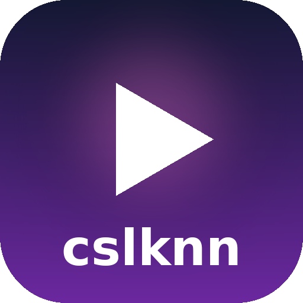
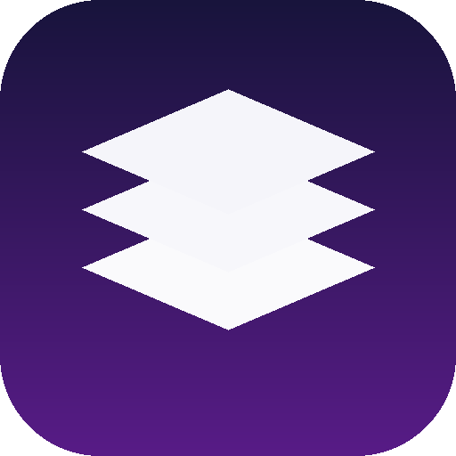

<p align="center">
  
</p>

<h1 align="center">cslknn</h1>

<p align="center">
  Yasal ve açık kaynaklardan film, dizi, belgesel ve canlı yayınları tek yerde toplayan CloudStream eklenti deposu.
</p>

<p align="center">
  <a href="https://github.com/aulukann-creator/cslknn/actions/workflows/build.yml"></a>
</p>

---

## Kurulum

**Tek dokunuşla:** Telefonunuzdan [kurulum sayfasını](https://aulukann-creator.github.io/cslknn/) açıp **CloudStream'e Ekle** butonuna basın.

**Elle:**

1. [CloudStream](https://github.com/recloudstream/cloudstream/releases) uygulamasını kurun.
2. **Ayarlar → Eklentiler → Depo ekle** yolunu izleyin.
3. Ad olarak `cslknn` yazın, adres olarak şunu yapıştırın:

```
https://raw.githubusercontent.com/aulukann-creator/cslknn/main/repo.json
```

4. Depoyu açıp istediğiniz eklentileri indirin.
5. Ana sayfada sağ üstten sağlayıcıyı seçin.

## Eklentiler

| | Eklenti | İçerik | Durum |
|---|---|---|---|
|  | **Kaynaklar** | Motor eklentisi: `sources/` klasöründeki tüm kaynaklar (NASA+, TRT Canlı ve eklediğiniz her şey) | ✅ |
|  | **Internet Archive** | Kamu malı filmler, klasik TV dizileri, çizgi filmler, sessiz sinema | ✅ |

### Kaynaklar eklentisindeki siteler

| | Kaynak | İçerik |
|---|---|---|
|  | **NASA+** | NASA'nın resmi belgeselleri ve 4K yapımları |
|  | **TRT Canlı** | TRT kanallarının resmi, şifresiz canlı yayınları |

## Yeni kaynak ekleme (tek dokunuş)

1. Repoda **Actions → Kaynak Ekle → Run workflow** açın.
2. Sitenin, YouTube kanalının, oynatma listesinin ya da M3U/RSS dosyasının adresini yazın, türü seçin, **Run workflow**'a basın.
3. Sistem sitenin yapısını algılar, tarifi üretir, canlı test eder ve repoya ekler. Sonuç raporu işin özet sayfasında görünür.
4. CloudStream'i yeniden başlatın; yeni kaynak **Kaynaklar** eklentisinde görünür.

Bir kaynağı kapatmak, açmak, silmek ya da yeniden test etmek için **Actions → Kaynak Yönet** kullanılır.

### Bilgisayardan ekleme (GitHub'ın ulaşamadığı siteler için)

Bazı resmi siteler yurt dışı sunuculara kapalıdır ama ev bağlantınızdan açılır. Bu durumda ekleme bilgisayardan yapılır:

1. Bir kez kurulum: [Python](https://www.python.org/downloads/) (kurarken *Add python.exe to PATH* işaretleyin) ve [Git](https://git-scm.com/download/win). Ardından:
   ```
   git clone https://github.com/aulukann-creator/cslknn
   ```
2. Her ekleme için `cslknn` klasöründe:
   ```
   powershell -ExecutionPolicy Bypass -File tools\kaynak-ekle.ps1 -Adres "https://ornek.com" -Tur belgesel
   ```
   Yalnızca denemek için sona `-Dene` ekleyin.

### Erişim analizi

Kaynak eklenirken araç önce siteye farklı başlık kombinasyonlarıyla (User-Agent, Referer, Origin, tarayıcı başlıkları) istek atar, çalışan en sade kombinasyonu bulup tarife yazar. Erişilemiyorsa sebebini raporlar: bölge kısıtı, giriş gerekli, bot koruması ya da sunucu hatası. Bot korumalı siteler eklenmez.

Yalnızca analiz için: `python tools\probe.py https://ornek.com`

Algılanan kalıplar: YouTube kanal/oynatma listesi · M3U kanal listesi · RSS/Atom video akışı · WordPress (wp-json) · JSON API · Next.js sayfaları · genel HTML (kart yapısı + og etiketleri + gömülü oynatıcı).

Tarif dosyalarının yapısı için `sources/` içindeki örneklere ve `tools/engine.py` başındaki açıklamaya bakın. Bir tarifi elle denemek için:

```
pip install -r tools/requirements.txt
python3 tools/engine.py test sources/nasa-plus.json -v
```

## İlke

Bu depodaki her eklenti yalnızca **hak sahibinin kendisinin yayınladığı** ya da **kamu malı / açık lisanslı** içeriklere bağlanır. Lisanssız yayın yapan sitelere yönelik eklenti eklenmez.

## Geliştirme

- Her klasör bir eklentidir. İçinde `build.gradle.kts` olan klasör otomatik olarak derlemeye katılır.
- `main` dalına yapılan her gönderimde GitHub Actions eklentileri derler ve `builds` dalına `.cs3` paketlerini ve `plugins.json` dosyasını yazar.
- Bir eklentiyi güncellediğinizde o eklentinin `build.gradle.kts` dosyasındaki `version` değerini bir artırın; CloudStream güncellemeyi buradan anlar.
